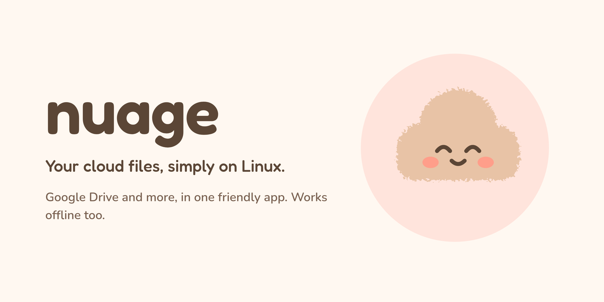

[](https://github.com/felixilgatto/nuage/actions/workflows/ci.yml)
[](LICENSE)

**Nuage puts your cloud storage in a regular folder on Linux.** Open it in
Files, work on your documents as usual: Nuage keeps them in sync.

> **Early development.** Google Drive and OneDrive are the most tested.
> Dropbox, pCloud and Proton Drive are in preview. The first release is
> being prepared: until it is out, build from source.

## What it does

- Each account appears as a folder you choose, visible in Files.
- An icon in the top bar tells you whether everything is up to date.
- See how much space is used and free.
- Pause and resume uploads.
- Leave some folders out of sync.
- Keep files and folders available offline (e.g. a password database).
- Works on servers too, from the command line.

Providers: **Google Drive** (with shared drives), **OneDrive**, **Nextcloud**,
**WebDAV** and **S3** bucket storage (Amazon S3, Cloudflare R2, Backblaze B2,
MinIO…); in preview, **Dropbox**, **pCloud** and **Proton Drive**
([details](docs/PROVIDERS.md)).

## Install

**Desktop** (Flatpak, x86-64 and ARM64), from the first release on. You
need Flatpak (on Ubuntu: `sudo apt install flatpak`), then open
[nuage.flatpakref](https://felixilgatto.github.io/nuage/nuage.flatpakref)
with Software, or run:

```sh
flatpak install --user https://felixilgatto.github.io/nuage/nuage.flatpakref
```

Nuage then updates with `flatpak update` and in Software, like any other
app. The GNOME runtime it needs comes from Flathub, added on the way if
needed. Each [release](https://github.com/felixilgatto/nuage/releases) also
has `.flatpak` bundles, which update the same way. Until the first release,
see [building from source](docs/BUILDING.md).

**Server**: `.deb` (Debian, Ubuntu), `.rpm` (Fedora, openSUSE) and a
tarball, for x86-64 and ARM64; see [docs/SERVER.md](docs/SERVER.md).

Requirement: `fuse3` (installed by default on Ubuntu).

**Uninstall** (desktop):

1. Quit Nuage (*Quit*, in its menu in the top bar or in the window's main
   menu), so your folders are unmounted. Avoid `flatpak kill`, which leaves a broken folder behind.
2. Remove the app and its data (settings, sign-ins, files kept offline):

   ```sh
   flatpak uninstall --user --delete-data io.github.felixilgatto.Nuage
   flatpak remote-delete --user nuage
   rm -f ~/.config/autostart/io.github.felixilgatto.Nuage.desktop
   ```

   The second line removes Nuage's repository (named `nuage-origin` instead
   if you installed a `.flatpak` bundle). Flatpak does not remove the start-at-login entry:
   the third line does.
   Your cloud folders stay, empty; delete them if you want.
3. Optionally, withdraw Nuage's access on the provider's side: Google
   <https://myaccount.google.com/connections>, Microsoft
   <https://account.live.com/consent/Manage>, Dropbox
   <https://www.dropbox.com/account/connected_apps>; or delete the app
   password or access key you created for Nuage.

## Get started

1. Open Nuage and pick a provider.
2. Sign in: in your browser, or, for Nextcloud, WebDAV, S3 and Proton
   Drive, with an address and a password or access key.
3. Choose the folder.

That's it. For your first Google account, Nuage first guides you through
creating your own Google access key (five minutes, free, done once; see
[why and how](docs/GOOGLE_OAUTH.md)).

Then Nuage lives in the top bar. Closing the window does not stop the sync.

## Command line

```sh
nuage status
nuage account add gdrive --client-id <id> --client-secret <secret>
nuage ls "Google Drive:Documents"
```

All commands: [docs/CLI.md](docs/CLI.md).

## Help

- [Providers](docs/PROVIDERS.md)
- [Troubleshooting](docs/TROUBLESHOOTING.md)
- [Nuage on a server](docs/SERVER.md)
- [Command line](docs/CLI.md)
- [Building and contributing](docs/BUILDING.md)
- [Adding a provider](docs/ADDING_A_PROVIDER.md)
- [Architecture](docs/ARCHITECTURE.md)

## Flatpak permissions

- `--talk-name=org.freedesktop.Flatpak`: used for one thing only, mounting
  and unmounting your folders with your system's `fusermount3`, through a
  small helper shipped with the app (`nuage-fuse-relay`). Nothing else runs
  outside the sandbox.
- `--filesystem=home`: lets you choose any folder in your home as a mount
  folder (it must have the same path inside and outside the sandbox).

## License

MIT, see [LICENSE](LICENSE). rclone, bundled in the packages, is also
MIT-licensed.
